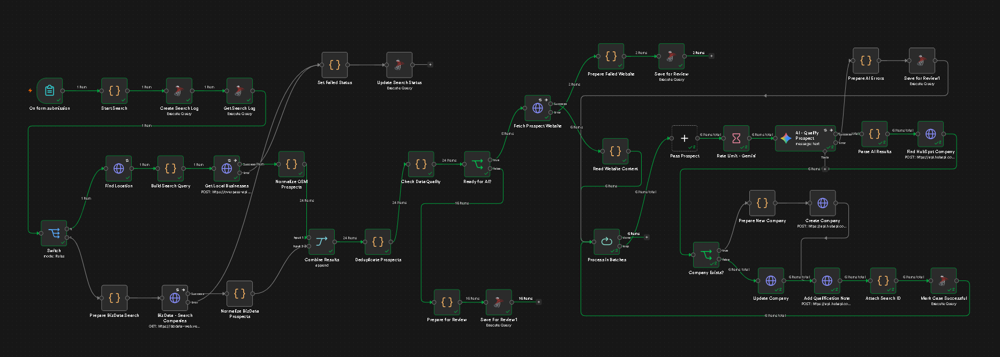

# AI B2B Prospect Intelligence Engine

### Finding businesses is easy. Finding the right businesses is where things get interesting.

Imagine having to search hundreds of businesses, check their websites, understand what they do, decide if they match your ideal customer profile, and then add everything to your CRM.

Doing all of that manually takes time. And honestly, a lot of that work can be automated.

So I built this.

The AI B2B Prospect Intelligence Engine is an n8n workflow that discovers businesses from multiple sources, collects available information, uses AI to evaluate potential customers, and organizes the results in HubSpot.

## What happens behind the scenes?

**Business discovery**: Collects business data from OpenStreetMap and BizData.

**Data processing**: Normalizes records into a common structure and removes duplicates.

**Website enrichment**: Checks business websites and collects available information.

**AI qualification**: Uses Gemini to evaluate prospects against the requested ideal customer profile.

**CRM integration**: Creates or updates company records in HubSpot.

**Manual review**: Keeps prospects with missing websites or failed website requests in a SQL review queue.

**Execution logging**: Records search failures and workflow execution details in SQL Server.

## The tech behind it

**n8n** – workflow orchestration

**OpenStreetMap** – local business discovery

**BizData API** – additional business discovery

**Gemini** – AI prospect qualification

**HubSpot** – CRM management

**Microsoft SQL Server** – logging and review queue

**JavaScript** – data transformation and processing

## Why I built it this way

I didn't want to build another workflow that simply collects business names and sends them to an AI model.

The bigger challenge is handling the data before and after AI gets involved.

Different sources return different data. Some businesses have no website. Some website requests fail. Some prospects are duplicates. And not every business is a good fit.

The workflow accounts for these situations instead of assuming every request will work perfectly.

## Workflow overview

- Submit an industry, location and ideal customer profile.

- Discover businesses from the selected sources.

- Normalize and deduplicate the results.

- Retrieve available website information.

- Evaluate each prospect using Gemini.

- Create or update the company in HubSpot.

- Store records requiring manual attention and log failures in SQL Server.

## Running the workflow

Import workflow.json into n8n.

You'll need to configure your own:

- Gemini API credentials

- HubSpot access token

- SQL Server connection

- Required API endpoints and settings

The exported workflow does not include credentials. Configure your own before execution.

## A note

This is a hands-on automation project focused on practical B2B prospecting, API integrations, AI-assisted qualification and handling real workflow failures.

There's still room to improve it, but the main goal was to build something that solves an actual business problem rather than just connecting a few nodes and calling it an AI agent.